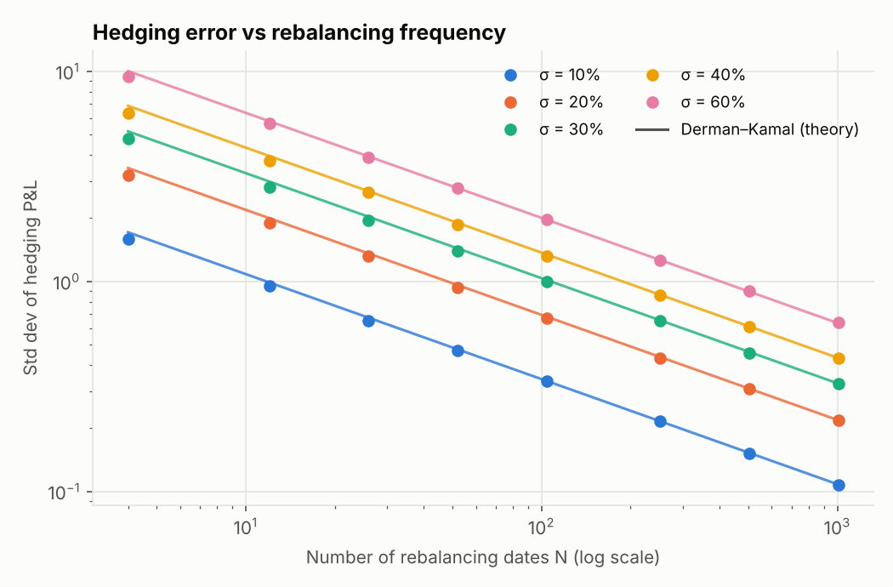
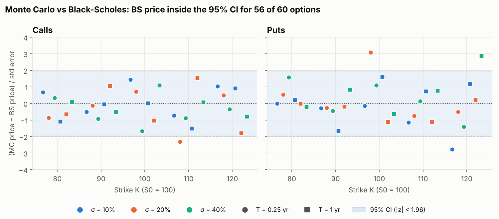
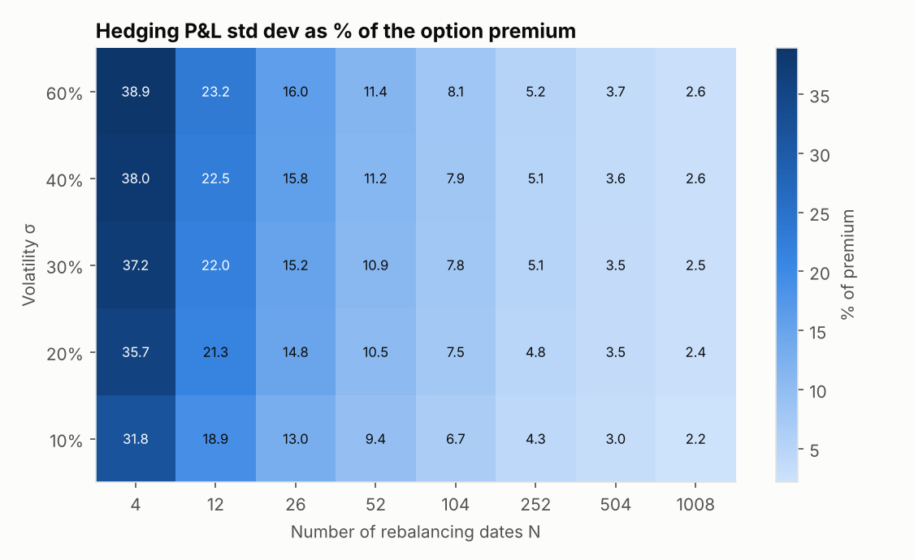

# Monte Carlo Pricing & Discrete Delta Hedging

Monte Carlo pricer for European options, simulation of discrete delta hedging, and
analysis of the hedging error as a function of volatility and rebalancing frequency.



*The hedging error decays as 1/√N for every volatility level, and the simulations
match the Derman–Kamal approximation √(π/4)·vega·σ/√N to within ~2%.*

## Project structure

```
mchedge/
  black_scholes.py   closed-form prices and Greeks (price, delta, gamma, vega) — benchmark
  monte_carlo.py     MC pricer: exact GBM, antithetic variates, control variate, 95% CI
  hedging.py         discrete delta-hedging simulation (vectorised across paths)
  analysis.py        parametric studies (MC validation, σ × N grid, vol mismatch, costs)
  plots.py           matplotlib charts
run_analysis.py      runs every study -> results/ (PNG + CSV)
tests/               pytest suite (put-call parity, MC vs BS, 1/√N scaling, ...)
```

## Getting started

```bash
python3 -m venv .venv
source .venv/bin/activate          # Windows: .venv\Scripts\activate
pip install -r requirements.txt

python run_analysis.py             # ~30 s; see --help for options
python -m pytest -q                # 11 tests
```

All runs use a fixed random seed (`--seed 42`), so results are reproducible.
Change it with `--seed` to see Monte Carlo noise. Other options include `--sigma`,
`--option put`, `--tc` (transaction cost) and `--paths`.

Direct use from Python:

```python
from mchedge import mc_european_price, simulate_delta_hedge

print(mc_european_price(S0=100, K=100, T=1, r=0.02, sigma=0.2, n_paths=500_000, seed=0))
res = simulate_delta_hedge(sigma_real=0.2, n_rebal=52, n_paths=20_000, seed=0)
print(res.summary())
```

## Methodology

**Monte Carlo pricer.** Under the risk-neutral measure,
`S_T = S0·exp((r − q − σ²/2)T + σ√T·Z)` is simulated exactly. Two variance-reduction
techniques are implemented:
- *Antithetic variates*: each draw `Z` is paired with `−Z`.
- *Control variate*: `X = e^{−rT}·S_T`, whose expectation `S0·e^{−qT}` is known.

When both are combined, the control-variate coefficient β is estimated on the
antithetic pair averages (the i.i.d. samples). Estimating it on individual draws
makes the combination *worse* than the control variate alone.

**Discrete delta hedging.** The trader sells the option at BS(σ_impl), buys Δ shares
and invests the rest at rate r. At each of N equally spaced dates, the position is
rebalanced to the BS delta at σ_impl. The underlying follows a GBM with realised
vol σ_real. The discounted final P&L is

`P&L = e^{−rT} · [ cash_T + Δ_{T−}·S_T − payoff(S_T) ]`

Optional proportional transaction costs: `tc · |ΔΔ| · S` at each rebalance.

**Reference theory.**
- Correct vol: P&L has mean ≈ 0 and standard deviation
  `σ_PnL ≈ √(π/4) · vega · σ / √N` (Derman & Kamal, 1999).
- Mis-specified vol: `E[P&L] ≈ BS(σ_impl) − BS(σ_real)`, i.e.
  `½ ∫ Γ·S²·(σ_impl² − σ_real²) dt` with gamma evaluated at σ_impl.

## Results

ATM call unless stated otherwise: S0 = K = 100, T = 1 year, r = 2%, 20,000 paths per hedging simulation.

### 1. Monte Carlo pricer



- **Validation against Black-Scholes** on 60 options (strikes 80–120, vols 10/20/40%,
  maturities 3 months and 1 year, calls and puts, 200k paths each): the BS price lies
  inside the 95% confidence interval for 56 of 60 options, with no pattern by strike,
  vol or maturity. Mean z-score −0.07 (expected 0), largest absolute error 0.016.
  Re-running over 480 options with different seeds gives a mean z of −0.02 and a
  standard deviation of 1.04: the pricer is unbiased and its confidence intervals
  are correctly calibrated.
- **ATM call, 500k paths**: 8.9088 ± 0.0082 vs BS 8.9160.
- **Variance reduction** (`01_mc_convergence.png`): ×1.7 with antithetic variates,
  ×5.4 with the control variate, ×23 with both. All methods converge at the same
  1/√n rate; variance reduction lowers the constant, not the exponent.

### 2. Hedging error vs volatility and rebalancing frequency



| Study | Finding |
|---|---|
| Error vs N | Log-log slope −0.487 for every vol (theory −0.5). Simulated / Derman–Kamal ≈ 0.98 (0.92 at N = 4, where the asymptotic formula is rough). |
| Error vs σ | Absolute error is roughly linear in σ (ATM vega is nearly constant). As a **% of the premium** it depends almost only on N: ~10% weekly, ~5% daily, ~2.5% at N = 1008. |
| P&L distribution | Centred on zero, fat-tailed at low N: gamma concentrates the error near the strike close to expiry (`05_pnl_distributions.png`). |

### 3. Extensions

| Study | Finding |
|---|---|
| σ_real ≠ σ_impl (`06_vol_mismatch.png`) | Simulated bias matches BS(σ_impl) − BS(σ_real) to within 0.01. Selling at 20% vol when realised vol is 30% costs ≈ 3.9. Dispersion also grows with the vol gap. |
| Transaction costs, 10 bp (`07_tc_tradeoff.png`) | Risk falls as 1/√N while costs grow ≈ √N: the costs + std-dev criterion is minimised around N ≈ 250 (daily). Beyond that, costs dominate. |

All charts are in `results/` and the underlying tables are saved as CSV files.

## Possible extensions

Stochastic volatility (Heston) for the realised vol, band-based hedging
(Whalley–Wilmott) instead of fixed dates, Leland's cost-adjusted volatility,
path-dependent payoffs (barriers, Asians).

## Reference

Derman, E. & Kamal, M. (1999). *When You Cannot Hedge Continuously: The Corrections
to Black-Scholes*. Risk, 12(1), 82–85.
